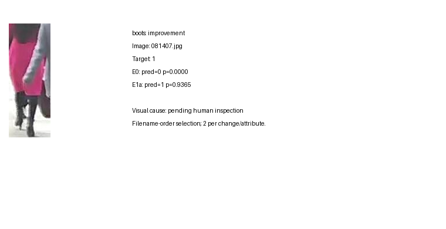
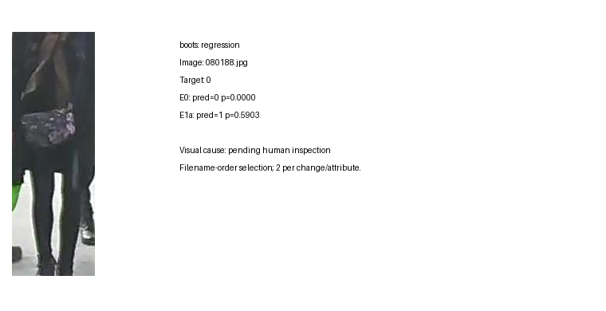
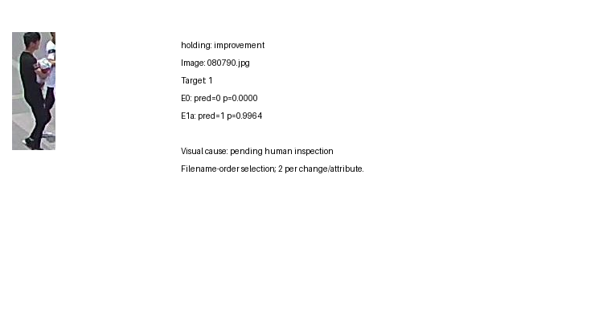
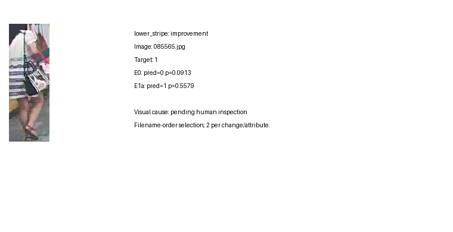
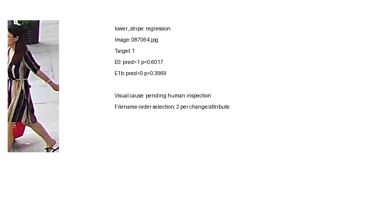
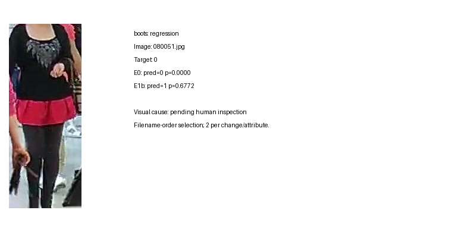

# A：类别不平衡、损失函数与评价指标

状态：2026-10-21 完成 E1a/E1b 各15轮训练、三个模型的完整验证集统一复评，以及返回预测的独立核算。本章为 A 线结果章节，可并入小组报告；尚不包含 B/C 的结果，也不代替小组最终提交清单。

## 术语约定

| 术语 | 本文定义 |
| --- | --- |
| PA100K | 本项目的行人属性数据集；目录名 PA-100K |
| BCE | 二元交叉熵，代码使用 BCEWithLogits |
| Focal Loss | 带 (1-p_t)^gamma 调制因子的二元交叉熵 |
| pos_weight | 训练集每属性负例数与正例数之比 |
| AttrAcc | 单属性 one-vs-rest 准确率；旧版九组平均准确率另记 legacy_mean_group_AttrAcc |
| mA | 每属性正例召回率与负例召回率的均值，再对属性平均 |
| P/R/F1 | Precision / Recall / F1；实例级指标逐图计算后平均 |

## 1. 研究问题与假设

本研究以共享的 ResNet18 分组分类头 baseline 为对照，检验两种损失改动对稀有属性漏检的影响。PA100K 的各属性正负比例差异很大，单独使用 AttrAcc 容易掩盖正例召回不足。根据仓库保存的 E0 诊断，boots、holding 和 lower_stripe 的验证集正例数分别为45、86和21，因此这些属性同时需要报告混淆计数，避免只用百分比解释少数样本的变化。

E1a 假设：提高正例损失贡献能够改善漏检，但可能同时增加假阳性。E1b 假设：降低易分样本对损失的贡献能够改变困难样本的学习效果；该作用是否能转化为稀有属性的 mA 或 F1 改善，需要实际对比验证。age_lt18 的损失保持不变，将其作为共享特征受到间接影响的观察项。

## 2. 损失函数

记二值标签为 y，模型输出 logit 为 z，p=sigmoid(z)。E0 对 binary/multilabel 组使用 BCE，对年龄和朝向的互斥组使用交叉熵，各组损失按原属性配置加权求和。

E1a 使用 L=-[w*y*log(p)+(1-y)*log(1-p)]，其中 w=N_negative/N_positive，仅根据训练标签统计。验证标签不用于计算权重；年龄、朝向的交叉熵保持原样。权重和数据配置随实验保存，便于核查实际优化目标。

E1b 使用 L=-(1-p_t)^gamma*log(p_t)，其中 p_t=y*p+(1-y)*(1-p)，gamma固定为2，主实验不启用额外 alpha 加权。代码通过稳定的 BCE 计算 p_t 对应调制项，避免直接计算 log(sigmoid(z)) 引起数值不稳定。单元测试验证 gamma=0 时退化为普通 BCE，并覆盖极端 logit 的有限损失和有限梯度。

Focal 不改变 softmax 组公式，但会改变 BCE 组损失的绝对量及共享特征的梯度。因此，即使年龄组指标发生变化，也不能据此声称其直接获得正例加权或 Focal 优化。

## 3. 公平对照与评价

三组实验固定训练/验证分割、seed=42、图像尺寸256x128、训练增强、ResNet18及分类头、优化器和学习率策略，训练15轮，batch size为64。E1a只启用pos_weight；E1b只替换binary/multilabel损失。最佳轮次仍由原九组平均AttrAcc选择，避免把更换选模指标混入损失实验。

统一评价对每个互斥组先argmax，再转one-hot；对binary/multilabel组使用logits>0。所有26个属性都累计TP、FP、FN、TN，分别计算AttrAcc、mA、P、R和F1。实例级P、R、F1则对每张图片的26维预测计算后平均。旧评价程序把互斥组分类准确率重复记录到各属性，这一旧口径保留用于核对E0和选模，不能与新的one-vs-rest单属性准确率混写。

比较优先观察总体宏mA、宏F1和实例级F1，并对boots、holding、lower_stripe、age_lt18逐项检查。若Recall提高而Precision下降，将通过FP、FN数量说明代价，不能仅报告有利指标。单个固定种子的结果只支持本配置下的描述性比较，不构成统计显著性证据。

## 4. 整体结果

表中单位均为百分比；差值使用未四舍五入的指标计算，记作百分点（pp）。Macro AttrAcc 对26属性等权，Legacy Acc 对九组等权，两者不可混用。

| 实验 | 最佳轮次 | Legacy Acc | Macro AttrAcc | Macro mA | Macro P | Macro R | Macro F1 | Instance P | Instance R | Instance F1 |
| --- | ---: | ---: | ---: | ---: | ---: | ---: | ---: | ---: | ---: | ---: |
| E0：BCE | 10 | 92.36 | 93.05 | 76.87 | 71.36 | 59.65 | 63.17 | 85.93 | 82.39 | 83.70 |
| E1a：pos_weight | 14 | 90.76 | 91.24 | 78.38 | 61.07 | 65.45 | 61.00 | 79.34 | 83.29 | 80.78 |
| E1b：Focal | 6 | 92.17 | 92.95 | 75.85 | 70.40 | 56.94 | 61.47 | 86.74 | 80.70 | 83.13 |

E1a 的宏 mA 比 E0 提高1.51 pp、宏 Recall 提高5.80 pp，但宏 Precision 下降10.28 pp、宏 F1 下降2.16 pp，实例 F1 下降2.92 pp。正例加权确实改变了漏检与误报的平衡，但不能称为整体性能全面提升。E1b 的宏 mA、宏 F1 和实例 F1 分别下降1.02、1.70和0.57 pp，本配置的难例聚焦没有转化为总体收益。

三组模型参数量均为12,365,146。E1a/E1b 在 RTX 4090 上的15轮训练流程耗时分别为937.24秒（15.62分钟）和980.21秒（16.34分钟），包含训练过程中的验证等流程开销，不是纯前向推理延迟。共享 E0 在 RTX 3090 上耗时1195.97秒（19.93分钟）；训练硬件不同，不能据此认定改进损失使训练加速。三者最终评价均在相同4090服务器软件栈、batch=64下完成。

## 5. 稀有属性及连带影响

| 属性（验证正例数） | 模型 | mA | P | R | F1 | TP | FP | FN |
| --- | --- | ---: | ---: | ---: | ---: | ---: | ---: | ---: |
| boots（45） | E0 | 53.29 | 27.27 | 6.67 | 10.71 | 3 | 8 | 42 |
| boots（45） | E1a | 57.45 | 9.59 | 15.56 | 11.86 | 7 | 66 | 38 |
| boots（45） | E1b | 62.00 | 19.64 | 24.44 | 21.78 | 11 | 45 | 34 |
| holding（86） | E0 | 51.73 | 50.00 | 3.49 | 6.52 | 3 | 3 | 83 |
| holding（86） | E1a | 57.49 | 50.00 | 15.12 | 23.21 | 13 | 13 | 73 |
| holding（86） | E1b | 51.71 | 33.33 | 3.49 | 6.32 | 3 | 6 | 83 |
| lower_stripe（21） | E0 | 59.49 | 40.00 | 19.05 | 25.81 | 4 | 6 | 17 |
| lower_stripe（21） | E1a | 61.66 | 9.26 | 23.81 | 13.33 | 5 | 49 | 16 |
| lower_stripe（21） | E1b | 50.00 | 0.00 | 0.00 | 0.00 | 0 | 0 | 21 |
| age_lt18（1443） | E0 | 80.41 | 88.64 | 62.16 | 73.08 | 897 | 115 | 546 |
| age_lt18（1443） | E1a | 72.35 | 92.50 | 45.32 | 60.84 | 654 | 53 | 789 |
| age_lt18（1443） | E1b | 86.85 | 89.96 | 75.12 | 81.87 | 1084 | 121 | 359 |

E1a 对 holding 的改善最明确：TP从3增至13，FP从3增至13，Precision仍为50%，F1从6.52%增至23.21%。boots 多检出4个正例，却新增58个FP，F1仅提高1.15 pp。lower_stripe 多检出1个正例，却新增43个FP，F1反而下降12.47 pp。三个属性的训练正例权重约为160.62、102.76、197.02（依次 boots、holding、lower_stripe），高权重增加正例损失贡献，但本次实验不能证明这些误报由某个具体视觉机制造成。

E1b 并非所有属性都退化：boots 的TP从3增至11，F1提高11.07 pp；但 holding 的TP保持3，FP增至6，未获收益。lower_stripe 的10,000张图全部预测为负，21个正例全部漏检，F1为0、mA为50%。尽管如此，其 AttrAcc 仍达到99.79%，甚至高于 E0 的99.77%。这直接说明极端不均衡下“准确率更高”可能只是识别了更多负例，不能替代正例指标。

性能变化也不限于预先关注的属性。E1a 的 upper_logo、upper_plaid、glasses 的F1分别下降10.10、10.57、6.31 pp，long_coat提高9.07 pp；E1b 的 upper_plaid、glasses分别下降13.51、9.71 pp，long_coat提高5.22 pp。完整26属性结果见 [补充表](all_attributes.md)，避免只呈现有利个例。

age_lt18 的 CE 未更改，但 E1a 的F1下降12.24 pp，E1b提高8.80 pp。因为分类头共享骨干，其他组的梯度变化可能间接影响年龄预测；Focal也改变了BCE组与CE组之间的相对损失规模。这是与实现相符的解释，尚不能区分特征共享、损失尺度、优化轨迹等因素，不能写成“年龄组直接采用Focal后改善”。

## 6. 逐图案例与失败分析

以下6例已查看实际导出图。标签均指数据集标注，不由图片外观重新判定；概率是模型输出分数，不是经校准的正确率。案例用于展示预测差异，不估计某类错误的发生频率。原导出器按文件名顺序各取前2个改善/退化候选，再从候选中选取下述说明性案例；“改善”包含纠正假阳性，不能一概解释为找回正例。图内的 pending human inspection 为原始导出提示，人工观察记录在各图下方；它不是未完成训练的标记。

### 6.1 E1a：找回正例，同时引入误报

图1，`data/081407.jpg`，boots标注1。E0输出0（分数0.000015），E1a输出1（0.936459）。图中黑色高筒鞋履区域可见，但与深色下装的边界不十分清晰。这是加权模型找回正例的实例；不能据此推断模型确实关注鞋筒区域，后者需要注意力或归因实验验证。

图2，`data/080188.jpg`，boots标注0。E0输出0（约0.00000012），E1a输出1（0.590255）。深色腿部、鞋履区域的细节有限，脚部接近裁剪边界。视觉歧义是可能的识别难点，但不足以断言标注有误。本例与整体boots假阳性从8增至66的代价一致。

图3，`data/080790.jpg`，holding标注1。E0输出0（0.000050），E1a输出1（0.996372）。图中手臂前方可见所抱持的对象；加权模型在此恢复了正例，与holding总体TP增加的方向一致。仅凭图像与输出分数不能证明改善来自某个局部特征。

图4，`data/085565.jpg`，lower_stripe标注1。E0输出0（0.091267），E1a输出1（0.557879）。下装可见横向条纹，部分区域被包遮挡；E1a得分略高于固定阈值。此例成功不抵消该属性总体F1下降，需与其FP由6增至49同时解释。

### 6.2 E1b：条纹漏检与鞋履误报

图5，`data/087064.jpg`，lower_stripe标注1。E0输出1（0.601694），E1b输出0（0.396895）。可见裙装条纹延伸到下半身，旁侧存在包及背景物体。本例说明即使条纹有可见线索，固定Focal配置仍可能漏检；全验证集21个正例均漏检是总体计数证据，而不应以单图推断其训练机制。

图6，`data/080051.jpg`，boots标注0。E0输出0（约0.00000024），E1b输出1（0.677193）。图中深色腿部与粉色裙装相邻，鞋履区域接近裁剪底部，局部信息不足可能造成歧义。该错误说明E1b在boots上虽提高召回和F1，仍伴随FP增加（8→45）；不能只报告其正面变化。

## 7. 结论、限制与后续

本次结果部分支持 E1a 的预设假设：正例加权提高宏mA与召回，但误报代价明显，宏F1与实例F1均下降；最稀有的lower_stripe并未得到F1收益。本次 E1b（gamma=2、alpha=None）不支持整体改进的假设，尽管boots与部分年龄指标局部提高。以本次预先固定的阈值和评价口径，E0在三个模型中仍具有最高宏F1与实例F1；若目标更重视正负类别均衡的mA，E1a可作为有代价的备选，不存在无需说明任务目标的统一赢家。

实验只有seed=42，不能声称统计显著或泛化到其他种子、数据集。三个重点属性验证正例极少，个别样本即可明显改变百分比。15轮训练、legacy选模以及固定0.5阈值均属于本次结论的条件；本研究未事后更换选模指标或调阈值来覆盖负面结果。E0复用历史训练，原记录不含训练标签哈希且训练硬件不同；E1两组训练标签哈希一致，三者验证标签和最终评价环境一致。服务器 E0 的26个混淆计数与原始诊断全部吻合，减少了统一评价口径偏移的疑虑，但不等价于重训复现E0。

可另设探索性实验比较权重截断、减弱加权强度、Focal alpha/gamma及损失尺度归一化；应另列实验编号并复跑对照，必要时使用独立校准划分，不能反复用同一验证集调参后继续称为预先约定的主实验。B/C结果返回后，可沿用统一指标汇总E0–E3；不能提前填入其未产生的数据。

## 8. 证据索引与复核范围

原始返回包：`D:/2026DIP/pro2/E1_results.zip`；完整预测保存在本地忽略目录 `runs/server_import_20261021/E1_suite`。小型交接证据见 [server_results](server_results)，含三个evaluation JSON、E1训练配置/15轮日志/summary、数据审计和当时源码清单；报告主体保留总表、重点属性和案例，完整属性表及训练过程移至补充材料。

新增独立核验程序 `starter_code/audit_e1_results.py` 使用NumPy重算：每模型10,000×26的混淆计数、逐属性/分组/宏指标及逐图实例指标；检查路径、属性顺序和标签完全一致，解码一致，最佳轮次与15轮日志吻合、pos_weight与训练统计吻合、源码清单哈希吻合。见 [results_audit.json](results_audit.json)，结果passed，指标误差容限1e-10（旧float32组指标容限1e-7）。服务器返回清单中的原训练/评价源码也与本地对应文件哈希一致。E1模型文件未包含在返回ZIP中，本地仅核验返回预测及元数据，未独立读取/重算E1权重哈希或重新执行模型前向。

旧 `e0_evaluation.json` 与 `e0_review.md` 是不同本地软件栈的临时CPU复评，保留用于追溯，不参与本章结果。正式E0见 `server_results/E0_review`，26/26属性混淆计数与原诊断相同。

方法来源：Lin, T.-Y., Goyal, P., Girshick, R., He, K., & Dollár, P. *Focal Loss for Dense Object Detection*, 2017，[作者原文页面](https://arxiv.org/abs/1708.02002)。该工作提出降低易分样本损失贡献的思路；其目标检测结果不能直接作为本项目属性分类有效性的证据。本章的PA100K效果结论全部来自上述实验记录。
