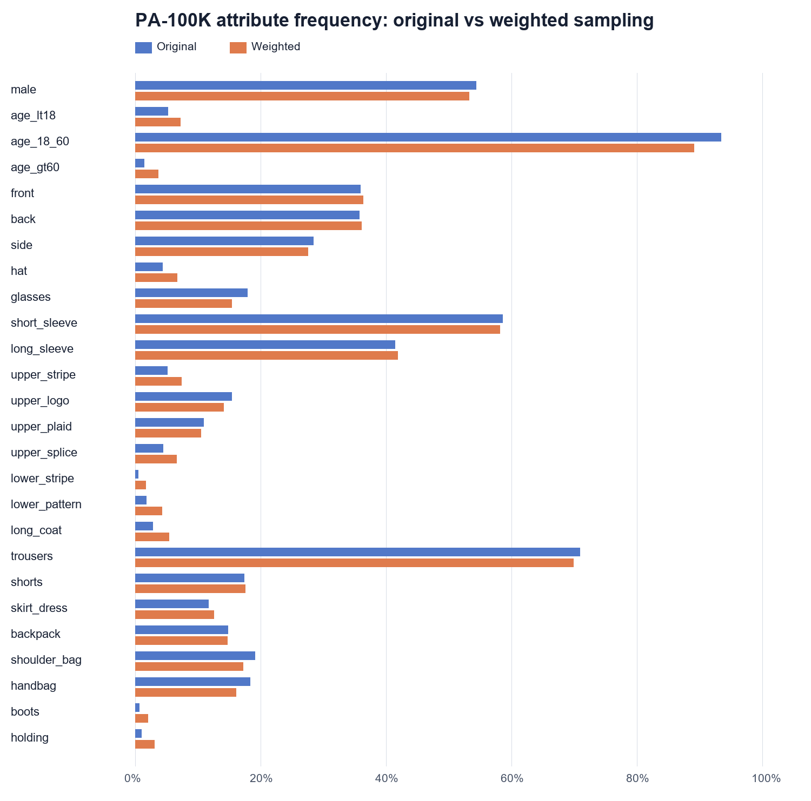
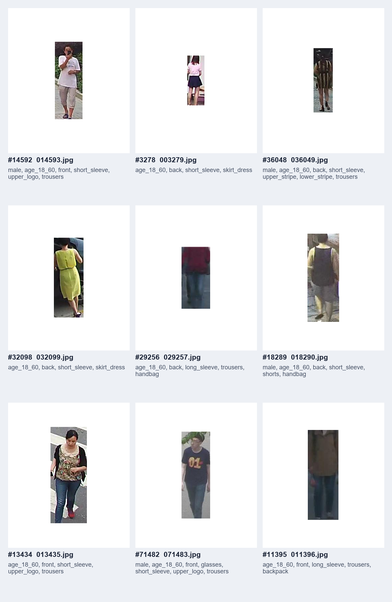
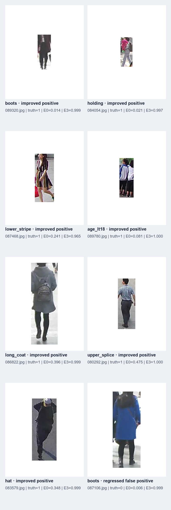
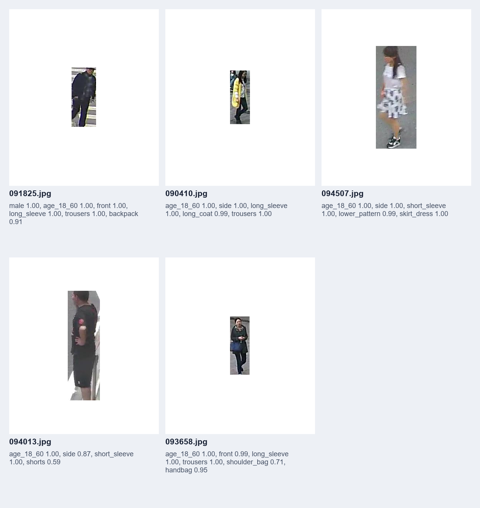

# E3：稀有属性加权采样

## 假设

仅把 E0 的随机打乱替换成 `WeightedRandomSampler`，让每个 epoch 看到更多稀有正例，可能提高 `boots`、`holding`、`lower_stripe`、`age_lt18` 等属性的 Recall、mA 和 F1。模型、损失函数、增强、优化器及训练轮数保持不变。

## 方法

训练集属性 `j` 的正例率记为 `p_j`，属性稀有度为：

```text
r_j = clamp(((1 - p_j) / p_j) ^ 0.5, 1, 10)
w_i = max(r_j for every positive attribute j in image i)
```

图片权重最后归一化为均值 1。采用正属性最大值而不是求和，避免一张多标签图片因为叠加多个权重而被极端重复；上限 10 进一步限制过采样。采样器使用独立、固定为 42 的随机数生成器，避免改变模型初始化。

运行命令：

```powershell
python starter_code/analyze_sampling.py --data-root data/pa100k --out experiments/E3
python starter_code/train.py --data-root data/pa100k --attention none --sampler weighted --epochs 15 --batch-size 64 --workers 4 --seed 42 --out runs/E3_weighted_sampler
python starter_code/compare_checkpoints.py --baseline-ckpt runs/baseline-e15/best.pt --candidate-ckpt runs/E3_weighted_sampler/best.pt --data-root data/pa100k --out experiments/E3
```

## 采样检查

| 属性 | 原始正例率 | 一个加权 epoch 的正例率 |
| --- | ---: | ---: |
| age_lt18 | 5.19% | 7.18% |
| age_gt60 | 1.41% | 3.70% |
| hat | 4.39% | 6.72% |
| lower_stripe | 0.50% | 1.66% |
| boots | 0.62% | 2.00% |
| holding | 0.96% | 3.03% |

一次 80,000 次有放回采样覆盖 47,804 张不同图片，32,196 张没有被抽到，20,295 张被重复抽取，单张图片最多出现 10 次。说明稀有正例确实增加，但每轮数据多样性也明显降低，这是 E3 的主要代价。





## 训练结果

E3 最佳 checkpoint 出现在第 13 轮。与仓库统一 E0 对照相比：

| 项目 | E0 | E3 | 变化 |
| --- | ---: | ---: | ---: |
| 九组平均 AttrAcc | 92.36% | 92.24% | -0.12 pp |
| 最佳 epoch | 10 | 13 | +3 |
| 参数量 | 12,365,146 | 12,365,146 | 0 |
| 本机 E3 总训练时间 | — | 35.49 min | — |

逐属性复评使用同一台机器上重新训练的 E0 checkpoint，以减少硬件和软件环境差异：

| 属性 | E0 Recall | E3 Recall | E0 mA | E3 mA | E0 F1 | E3 F1 |
| --- | ---: | ---: | ---: | ---: | ---: | ---: |
| age_lt18 | 51.35% | **56.48%** | 75.32% | **77.78%** | 66.01% | **69.75%** |
| lower_stripe | 4.76% | **14.29%** | 52.36% | **57.09%** | 7.69% | **17.65%** |
| boots | 4.44% | **6.67%** | 52.17% | **53.32%** | 6.90% | **11.76%** |
| holding | 3.49% | **5.81%** | 51.73% | **52.88%** | 6.52% | **10.31%** |
| age_gt60 | **13.10%** | 7.14% | **56.48%** | 53.52% | **20.37%** | 12.00% |
| hat | **32.01%** | 29.78% | **65.84%** | 64.67% | **45.74%** | 42.48% |

实例级指标也略有下降：Precision 从 85.86% 变为 85.46%，Recall 从 82.43% 变为 82.02%，F1 从 83.71% 变为 83.29%。因此 E3 是“部分稀有属性改善、整体略有代价”的混合结果，不能仅凭几个成功案例宣称全面提升。

## 错误案例分析



- `089320.jpg`：鞋靴区域很小且与黑色长裤连成一片；E3 正确识别 boots，说明重复看到靴子正例后对局部暗色形状更敏感。
- `084054.jpg`：手持物体被身体和背包遮挡，E0 漏检，E3 给出高置信度正例。
- `087468.jpg`：裙装下半部分有明显竖向条纹；E3 修正了 E0 的 lower_stripe 漏检。
- `089780.jpg`：人物较小且多人遮挡，年龄线索有限；E3 将 age_lt18 从低置信度改为正确类别。
- `086822.jpg`：背面长外套轮廓清楚，但颜色和裤子接近；E3 修正 long_coat 漏检。
- `080292.jpg`：上衣由不同纹理区域拼接，E3 修正 upper_splice 漏检。
- `083579.jpg`：头部区域较暗且帽子边界不清楚；E3 修正 hat 漏检。
- `087106.jpg`：黑色裤袜、鞋和阴影形成连续深色区域，E3 将其误判为 boots，体现过采样会放大相似外观导致的假阳性。

## 测试集 Demo

以下 5 张测试图片由固定随机种子 42 选择，展示 E3 最佳 checkpoint 在未参与训练和选模的测试图片上的属性预测及置信度。完整机器可读结果见 [`test_demo_predictions.json`](test_demo_predictions.json)。



## 结论

当前权重公式验证了加权采样能够显著提高极稀有属性在一个 epoch 中的出现率，并改善 `lower_stripe`、`boots`、`holding` 和 `age_lt18` 的正例识别；但它降低了每轮样本多样性，并使 `age_gt60`、`hat`、整体 AttrAcc 和实例级 F1 下降。E3 不建议直接替代 E0 作为最终模型。后续可以把最大权重从 10 降至 5，或使用分组采样/温和混合采样，验证能否保留稀有属性收益并减少过拟合。

完整配置、逐轮日志、逐属性 CSV/JSON 和所有图片均保存在本目录。模型权重保留在本地 `runs/E3_weighted_sampler/`，不进入普通 Git 历史。
