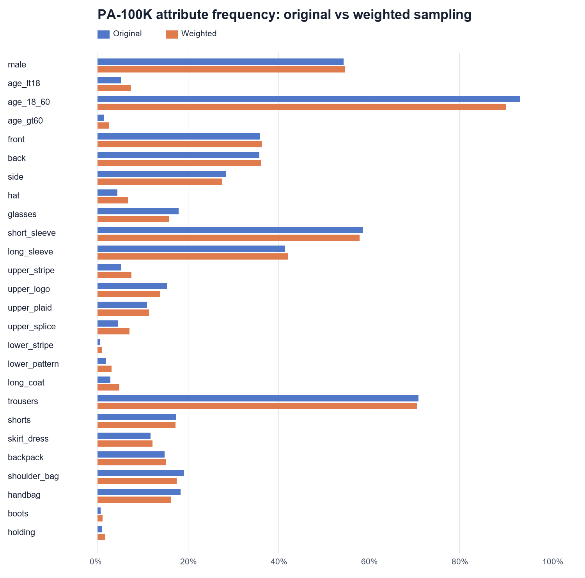
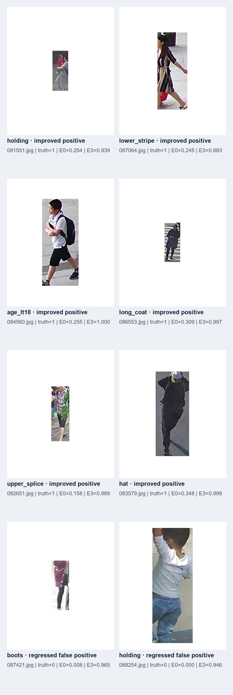

# E3b：温和加权采样消融实验

## 目的

E3 使用最大属性权重 10，能够改善部分极稀有属性，但一个 epoch 只覆盖 47,804 张不同图片，整体 AttrAcc 与实例级 F1 略降。E3b 只把 `sampler_max_weight` 从 10 降到 5，验证降低过采样强度能否恢复样本多样性和整体性能。

模型、损失函数、数据增强、随机种子、优化器、batch size 和 epoch 均与 E0/E3 相同。

```powershell
python starter_code/analyze_sampling.py --data-root data/pa100k --out experiments/E3b --sampler-max-weight 5
python starter_code/train.py --data-root data/pa100k --attention none --sampler weighted --sampler-max-weight 5 --epochs 15 --batch-size 64 --workers 4 --seed 42 --out runs/E3b_weighted_sampler_cap5
```

## 采样强度

| 项目 | E3（上限 10） | E3b（上限 5） |
| --- | ---: | ---: |
| 一个 epoch 覆盖的不同图片 | 47,804 | 49,081 |
| 没有被抽到的图片 | 32,196 | 30,919 |
| 单张图片最大重复次数 | 10 | 9 |
| 归一化后的最大图片权重 | 3.156 | 1.693 |

| 属性 | 原始正例率 | E3 采样率 | E3b 采样率 |
| --- | ---: | ---: | ---: |
| age_lt18 | 5.19% | 7.18% | 7.33% |
| age_gt60 | 1.41% | 3.70% | 2.42% |
| lower_stripe | 0.50% | 1.66% | 0.87% |
| boots | 0.62% | 2.00% | 1.05% |
| holding | 0.96% | 3.03% | 1.62% |



## E0、E3、E3b 结果

E3b 最佳 checkpoint 出现在第 7 轮，总训练时间 37.73 分钟。

| 项目 | E0 | E3 | E3b |
| --- | ---: | ---: | ---: |
| 九组平均 AttrAcc | **92.36%** | 92.24% | 92.32% |
| 实例级 Precision | 85.86% | 85.46% | **86.02%** |
| 实例级 Recall | **82.43%** | 82.02% | 81.77% |
| 实例级 F1 | **83.71%** | 83.29% | 83.41% |

逐属性复评中的 E0 使用同一台机器重新训练的 checkpoint：

| 属性 | E0 Recall / F1 | E3 Recall / F1 | E3b Recall / F1 |
| --- | ---: | ---: | ---: |
| age_lt18 | 51.35% / 66.01% | 56.48% / 69.75% | **69.99% / 80.00%** |
| upper_splice | 65.48% / **69.92%** | 63.49% / 66.12% | **69.05%** / 69.60% |
| lower_stripe | 4.76% / 7.69% | **14.29% / 17.65%** | 9.52% / 16.00% |
| long_coat | 52.19% / 61.83% | 49.77% / 60.42% | **63.69% / 64.37%** |
| boots | 4.44% / 6.90% | **6.67% / 11.76%** | 2.22% / 4.00% |
| holding | 3.49% / 6.52% | **5.81% / 10.31%** | 2.33% / 4.35% |

E3b 对 `age_lt18` 和 `long_coat` 的提升明显，并追回大部分总体 AttrAcc；但对极端稀有的 `boots`、`holding`，权重上限 5 太弱，效果反而低于 E0。E3 与 E3b 揭示了明确的强度权衡：较强采样更适合极端稀有属性，较温和采样更适合中等稀有属性和总体稳定性。



## 结论

E3b 是比 E3 更均衡的设置，但仍没有在所有指标上超过 E0。若以总体性能为主，保留 E0；若课程报告强调稀有属性召回，使用 E3 展示 `boots`、`holding`、`lower_stripe` 的改善，并用 E3b 说明采样强度消融及其权衡。下一步不建议继续盲目搜索更多上限，而应等待 A 的 Focal Loss 结果，判断损失加权是否比重采样更稳定。

完整配置、逐轮指标、逐属性比较和图片均保存在本目录。模型权重保留在本地 `runs/E3b_weighted_sampler_cap5/`，不进入普通 Git 历史。
